# Лабораторная по GIT

## Отчёт

**Цель:** научится пользоваться системой контроля версий git

### Ход работы:

### Оценка 3:

1. Используем git status,чтобы узнать, на какой ветке мы находимся и посмотрим как выглядит git log

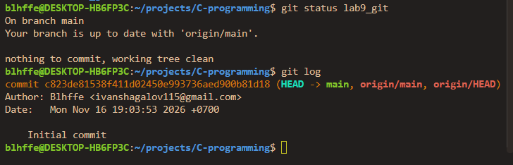

2. Создадим файл sort.c, в котором находится код quick sort, после этого посмотрим как выглядит git status 

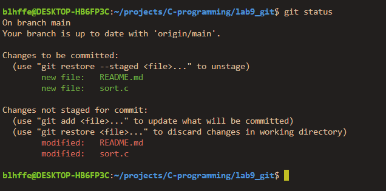

3. Добавим файл в область stage и посмотрим как выглядит git status 

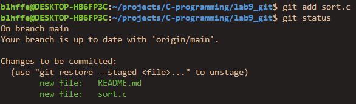

4. Закоммитим файл в репозиторий и выведем git status

5. Добавим комментарий в файл sort.c

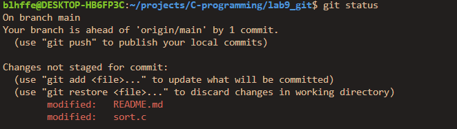 

6. Добавим в файл в область и посмотрим как выглядит git status

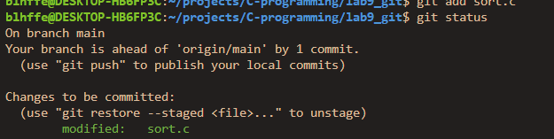 

7. Уберём ранее написанный коментарий и закоммитим посмотрим статус и логи

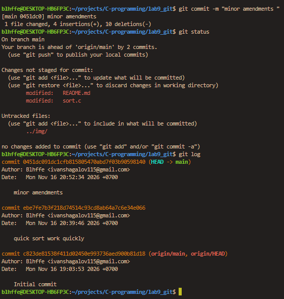

8. Добавим в область, закоммитим последнее изменение и запушим на удалённый репо

#### Ветки ####

1. Используем git branch mybranch, чтобы создать новую ветку с именем mybranch, затем посмотрим в какой ветке нажодимся и перейдём на ранее созданную ветку

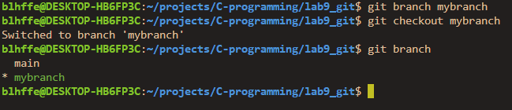

2. При использовании git status видно, что первая строка меняется, если находимся в корневой (главной) ветке git выводит on main branch, а если в другой то название этой ветки.

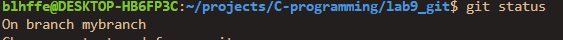

3. Создадим файл с именем file1.txt и файл filebimbam.txt в ветке mybranch  закоммитим их

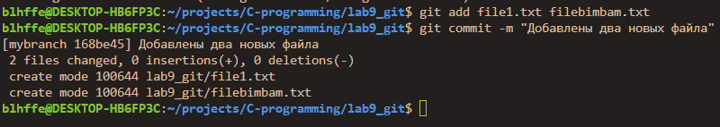
 
 4. С помощью git log --oneline --graph посмотрим что наша ветка указывает на новый коммит

 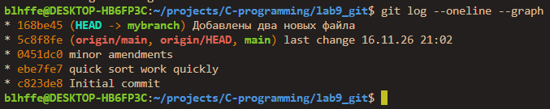

5. Создадим файл file2.txt в main ветке и посмотрим содержимое каждой ветки.

Видно, что при переключении между ветками файлы созданные в разных ветках недоступны, например, в mybranch нельзя получить доступ к файлам file1.txt и filebimbam.txt ведь они находятся в main ветке.

6. Чтобы наглядно убедится используем git diff mybranch main.

7. Запушим на репо mybranch и main

### Оценка 4:

1. Переключимся на mybranch. Изменим файл sort.c добавив функцию int main и посмотри что выводит git diff.

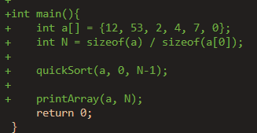

git diff сообщает нам, что файл был изменён и показывает, что конкретно было изменено. В нашем случает знак "+" указывает на добавление новых строк кода. 

2. git diff --staged ничего не выводит, поскольку файл не был добавлен в область подготовленных файлов.

3. Добавим в файл в область и посмотрим, что выведут ранее использованные команды:

git diff теперь пустой, поскольку изменения были добавленны в область и расхождения по индексам нет.

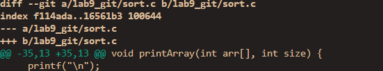

git diff -staged показывает добавленные строки и сравнивает индекс с последним коммитом

4. Уберём любое число из масива и посмотрим, что выводит git diff:

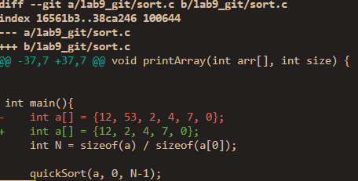

Команда говорит что была изменена строчка, а именно знак "-" указывает на удалённый элемент, а знак "+" на добавленный (массив без удалённого числа)

Также посмотрим как выглядит команда git diff --staged:
Эта команда показывает предыдущий результат вызова, ведь только что изменённый файл не был добавлен в область подготовленных. 

5. Вызовем команду git status и обратим внимание на два файла sort.c:

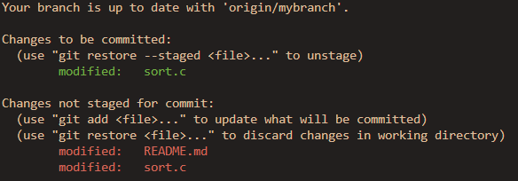

Так произошло, потому что в разделе "Changes to be committed" это ранее добавленный в область файл (до изменений), a раздел "Changes not staged for commit" отображает sort.c изменённый.

15. Выполним команду git restore --staged sort.c и вызовем статус.

Зелёный блок "Changes to be committed" исчез. Файл sort.c теперь отображается только один раз красным цветом в разделе "Changes not staged for commit", но сами правки в файле на диске сохранились.

16. Изменим содержание файла sort.c, добавив в main команду "printf("Hello git\n");"

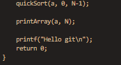

git status говорит, что файл sort.c на данный момент изменяется и не сохранён в область stage.

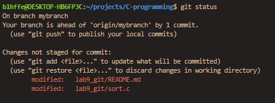

17. Вызовем команду git restore sort.c посмотрим содержимое файла и вызовем git status

Команда git restore отменила изменение файла:

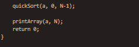

Запушим на удалённый репо ветку.

#### Ветки и ff-merge ####

1. Создадим файл greeeting.txt, добавим в область stage и закомитим его

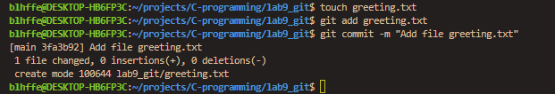

2. Добавим в файл слово hello, добавим в область и закомитим

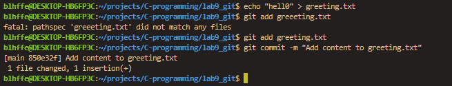

3. Создадим ветку feature/uppercase

4. Переключимся на новую ветку и вызовем статус

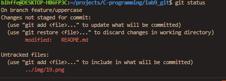

Команда нам говорит, что мы находимся на новой ветке.

5. Отредактируем файл greeting.txt, чтобы он содержал приветствие в верхнем регистре (HELLO), добавим файл в область и закомитим его.

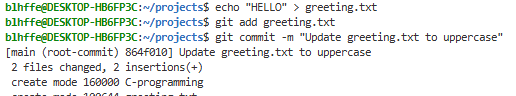

6. Вызовем команды git branch и git log --oneline --graph --all

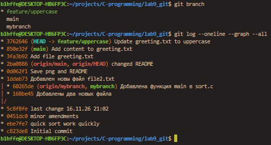

Команды показывают: ветку на которой мы находимся и все изменения во всех ветках (коммиты)

7. Переключимся на главную ветку и посмотрим содержимое файла greeting.txt

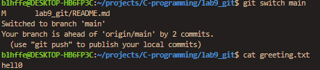

Видно что, содержимое файла нне поменялось, посколько все изменения происходили в другой ветке.

Также сравним и объединим ветки:

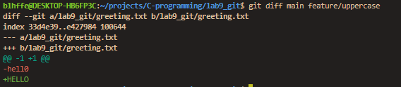

Команда git diff main feature/uppercase показывает что содержимое файлов разнится (hello было заменено на HELLO)

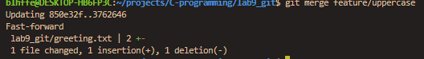

Слияние веток прошло через способ fast-forward, т.е указатель гланой ветки передвинулся вперёд на последний коммит присоединяемой ветки.

8. Посмотрим содержимое файла после слияния веток

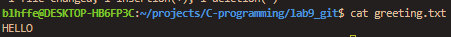

Видно, что содержимое файла в главной ветке поменялось на содержимое ветки feature/uppercase

Удалим ветку

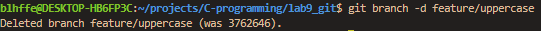

9. Сольём ветку mybranch в main

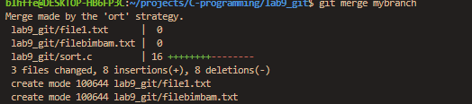

При слиянии использовался метод ORT, который создал специальный merge-коммит с двумя родителями, объединив изменения из обеих веток.

Вызовем команду git log --oneline --graph --all

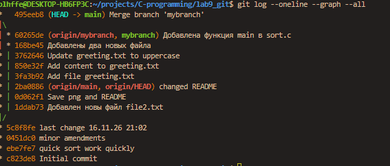

На графе видно разветвление веток и последущее слияние в общий коммит.

Запушим главную ветку на удалнный репо.