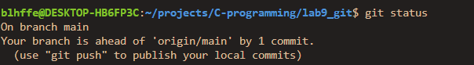

# Лабораторная по GIT

## Отчёт

**Цель:** научится пользоваться системой контроля версий git

### Ход работы:

1. Используем git status,чтобы узнать, на какой ветке мы находимся и посмотри как выглядит git log

2. Создадим файл sort.c, в котором находится код quick sort, после этого посмотрим как выглядит git status 

3. Добавим файл в область stage и посмотрим как выглядит git status 

4. Закоммитим файл в репозиторий и выведем git status

5. Добавим комментарий в файл sort.c
 

6. Добавим в файл в область и посмотрим как выглядит git status
 

7. Уберём ранее написанный коментарий и закоммитим посмотрим статус и логи

8. Добавим в область, закоммитим последнее изменение и запушим на удалённый репо
